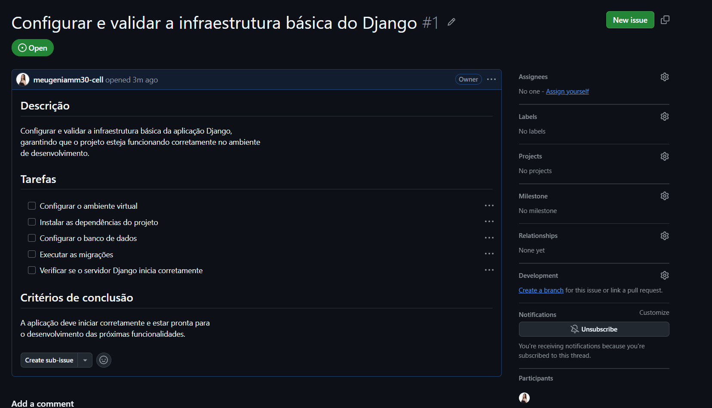
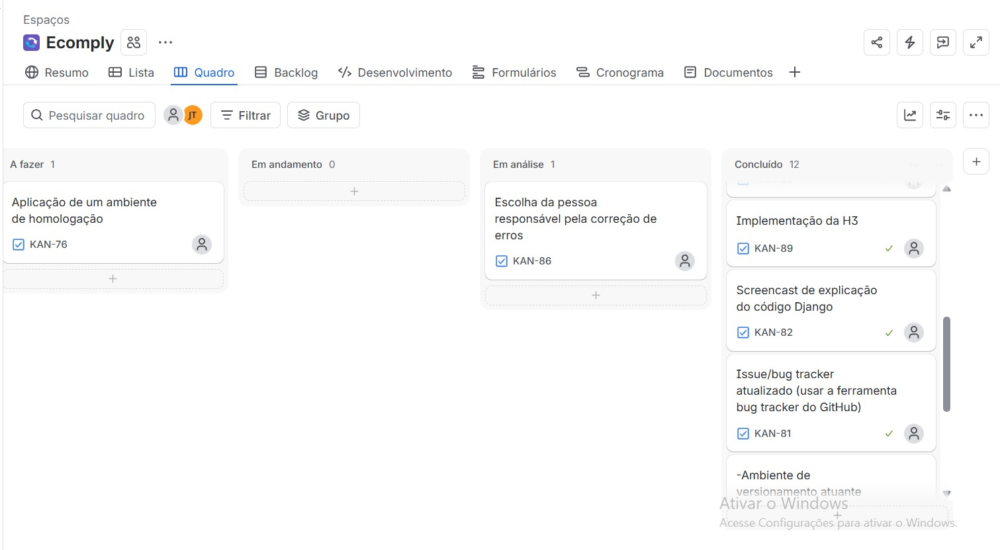
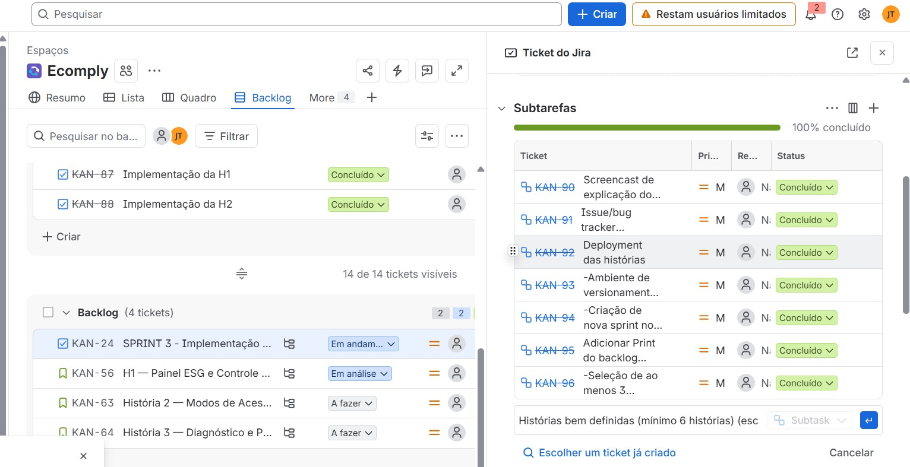

# Ecomply 🌳

## Sobre nosso projeto

Este projeto tem como objetivo ressignificar a importância das práticas de ESG
para pequenas e médias empresas que atuam no comércio eletrônico.

A proposta é tornar o ESG mais simples e acessível para os pequenos
e-commerces, mostrando como práticas ambientais, sociais e de governança podem
ser aplicadas no dia a dia e contribuir para o desenvolvimento do negócio.

---

## Tecnologias Utilizadas

- Python
- Django
- Git e GitHub

---
## Ferramentas Utilizadas

- Visual Studio Code
- GitHub

# Entregas

## Entrega 01 — Análise de Concorrentes

Nesta primeira entrega foi realizada uma análise de soluções existentes
relacionadas a ESG, sustentabilidade e e-commerce.

Foram analisados cinco concorrentes:

- Mangue Tech
- Carbonova
- Sebrae — Crescimento Sustentável
- Paresi
- Jornada da Sustentabilidade

A análise considera o funcionamento de cada solução, seus pontos fortes e
pontos fracos, além de um benchmark comparativo.

### Artefatos

- [Análise completa de concorrentes](Analise_de competidores.md)
- [Benchmark](https://i.ibb.co/Ng0vSX9V/benchmarking-esg-ecommerce-full-hd.png)

### Screenshots

  
  
  

  
  
  

  

---

# Equipe

| Nome | E-mail School | 
Ana Júlia de Melo Costa  ajmcs2@cesar.school 
Arthur Marenga Paranhos  amp4@cesar.school 
Daniel Santana Bezerra   dsb3@cesar.school 
José Victor Telles de Araujo Pereira Tavares   Jvtapt@cesar.school 
Maria Eugênia Mateus Moraes  memm@cesar.school 
Marcos Luiz Galdino Berto Alves mlgba@cesar.school

---

## Entrega 02

## Issue/Bug Tracker

O projeto utiliza o Issue Tracker do GitHub para registrar,
acompanhar e organizar tarefas e possíveis bugs encontrados
durante o desenvolvimento.

### Issue de acompanhamento

## Link do Jira

https://victor0609.atlassian.net/jira/software/projects/KAN/boards/1/backlog?selectedIssue=KAN-16&atlOrigin=eyJpIjoiYThiYTMzYjdlZDE4NDdmZDhkNWNlNmQ0MjZiMGEwNmEiLCJwIjoiaiJ9

## Link da apresentação do site

https://youtu.be/cuc5XAlUUAI?is=H_MAsDdn_2Gf-QeC

https://youtu.be/PsEGuZzJZvU?is=CSefCLgD33U2sdVN

## Finalização do projeto (22/09/2026 00:01)

## Link do site 

https://ecomply-5taq.onrender.com/

---

## Entrega 03 

## Histórias de Usuário

- [Histórias de Usuário — Ecomply](historias_usuario.md)

## Histórias implementadas no formato post-it

| POST-IT 01 — Portal da Transparência ESG |
|---|
| **História de usuário** |
| Como empreendedor, quero publicar os resultados ESG da minha empresa, para demonstrar transparência e compromisso com práticas sustentáveis aos consumidores. |
| **Critérios de aceitação** |
| • O sistema disponibiliza uma área para publicação das informações ESG da empresa. • O empreendedor pode publicar seus resultados ESG. • O empreendedor pode retirar a publicação e publicá-la novamente. • Os visitantes podem consultar as informações publicadas. |

 

| POST-IT 02 — Modo Dislexia |
|---|
| **História de usuário** |
| Como usuário com dificuldades de leitura, quero ativar um modo de acessibilidade com fontes e espaçamentos adaptados, para navegar pela plataforma com mais facilidade. |
| **Critérios de aceitação** |
| • O sistema disponibiliza uma opção para ativar o modo dislexia. • Ao ativar o modo, os textos são adaptados para facilitar a leitura. • O usuário pode desativar o modo dislexia quando desejar. • O sistema mantém a preferência de acessibilidade durante a navegação. |

 

| POST-IT 03 — Diagnóstico ESG |
|---|
| **História de usuário** |
| Como empreendedor, quero responder a um questionário sobre as práticas ambientais, sociais e de governança da minha empresa, para identificar seu desempenho ESG e os pontos que precisam de melhorias. |
| **Critérios de aceitação** |
| • O sistema disponibiliza um questionário sobre as dimensões ambiental, social e de governança. • O empreendedor pode responder ao diagnóstico da empresa cadastrada. • Após a conclusão, o sistema apresenta o resultado ESG. • O empreendedor pode consultar o histórico de diagnósticos realizados. |

 

| POST-IT 04 — Aviso de Privacidade |
|---|
| **História de usuário** |
| Como usuário da plataforma, quero visualizar um aviso de privacidade e acessar a política de tratamento de dados, para compreender como minhas informações pessoais são utilizadas. |
| **Critérios de aceitação** |
| • O sistema apresenta um aviso de privacidade ao usuário. • O aviso contém um link para a Política de Privacidade. • O usuário pode confirmar a visualização clicando em "Entendi". • O sistema registra a confirmação no navegador para evitar a exibição repetida do aviso. |

 

| POST-IT 05 — Calculadora de Embalagens |
|---|
| **História de usuário** |
| Como empreendedor, quero calcular e comparar informações sobre as embalagens utilizadas nos meus produtos, para identificar alternativas mais sustentáveis para minha empresa. |
| **Critérios de aceitação** |
| • O sistema disponibiliza uma calculadora de embalagens. • O empreendedor pode informar os dados necessários para o cálculo. • O sistema apresenta os resultados com base nas informações fornecidas. • O empreendedor pode utilizar os resultados para comparar alternativas de embalagens. |

 

| POST-IT 06 — Dashboard ESG |
|---|
| **História de usuário** |
| Como empreendedor, quero visualizar os principais indicadores ESG da minha empresa em um painel, para acompanhar seu desempenho e facilitar a tomada de decisões. |
| **Critérios de aceitação** |
| • O sistema disponibiliza um dashboard para acompanhamento da empresa. • O painel apresenta informações e indicadores relacionados à gestão ESG. • O empreendedor pode visualizar os dados da empresa selecionada. • As informações permitem acompanhar o desempenho ESG da empresa. |

 

| POST-IT 07 — Plano de Ação ESG |
|---|
| **História de usuário** |
| Como empreendedor, quero cadastrar e acompanhar ações de melhoria relacionadas ao ESG, para organizar iniciativas sustentáveis e monitorar seu progresso. |
| **Critérios de aceitação** |
| • O sistema disponibiliza uma área para gerenciamento de planos de ação ESG. • O empreendedor pode cadastrar ações de melhoria para sua empresa. • O sistema permite acompanhar as ações registradas. • O empreendedor pode consultar as iniciativas planejadas. |

 

| POST-IT 08 — Cadastro de Empresas |
|---|
| **História de usuário** |
| Como empreendedor, quero cadastrar e gerenciar minhas empresas na plataforma, para acompanhar individualmente suas informações e práticas ESG. |
| **Critérios de aceitação** |
| • O sistema disponibiliza um formulário para cadastro de empresas. • O empreendedor pode registrar as informações de suas empresas. • O sistema apresenta as empresas cadastradas pelo usuário. • O empreendedor pode acessar as informações de cada empresa. |

 

| POST-IT 09 — Controle Financeiro |
|---|
| **História de usuário** |
| Como empreendedor, quero registrar e acompanhar as informações financeiras do meu negócio, para controlar melhor os recursos e apoiar o planejamento da empresa. |
| **Critérios de aceitação** |
| • O sistema disponibiliza uma área de controle financeiro. • O empreendedor pode registrar informações financeiras da empresa. • O sistema apresenta os dados financeiros registrados. • O empreendedor pode consultar essas informações para acompanhar a situação financeira do negócio. |

## Issue/Bug Tracker atualizado

A Issue #1 reúne as funcionalidades já desenvolvidas e as tarefas que ainda estão pendentes.

Issue #1 — Acompanhamento do desenvolvimento

  
  
  
  

Issue #2 — Testes e bugs

Também criamos a Issue #2 para verificar possíveis erros na aplicação.

Foram realizadas 16 verificações, incluindo cadastro, login, perfil, feedback, navegação e banco de dados. Não foram identificados bugs nos testes realizados.

  
  
  

A Issue #1 continua aberta para acompanhar as próximas funcionalidades, enquanto a Issue #2 foi fechada após a conclusão dos testes.

## Link do vídeo interno do Ecomply (código)
https://youtu.be/jH9BQNj_Gn8?is=lUfa6UXB_3NZ-K5k

## Link do vídeo sobre as novidades do site
https://youtu.be/dNT4FYKQnFU?feature=shared

## Quadro do Jira — Entrega 03

O quadro do Jira foi utilizado para organizar e acompanhar as atividades do projeto Ecomply, permitindo visualizar o andamento das tarefas da equipe.

## Sprint 03 e Backlog

A Sprint 03 reúne as atividades planejadas para esta entrega, enquanto o backlog apresenta as tarefas e funcionalidades organizadas para o desenvolvimento do Ecomply.

